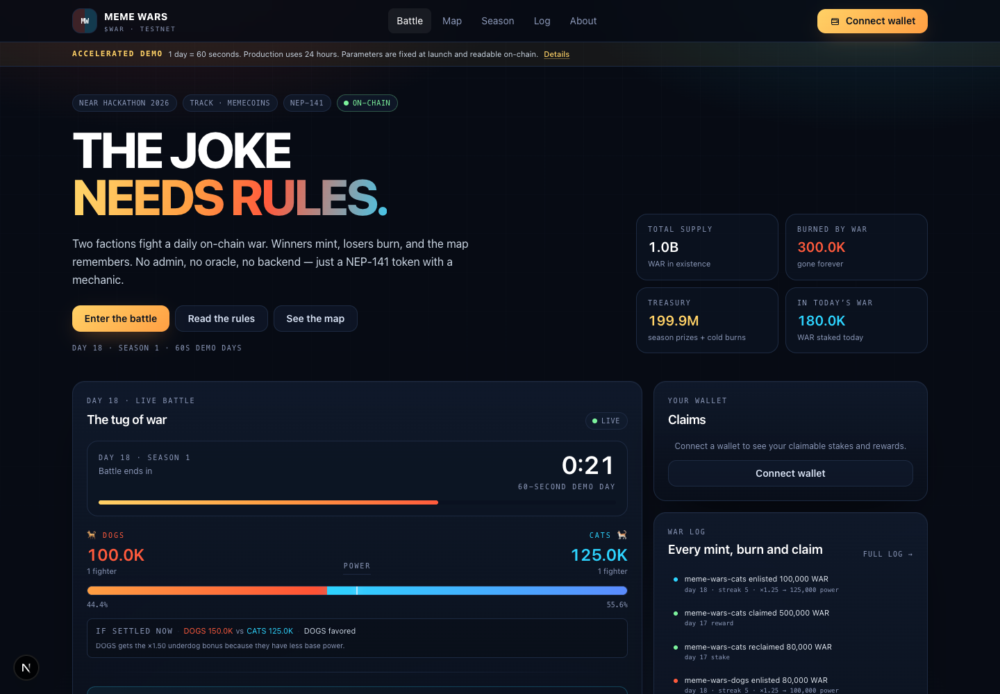
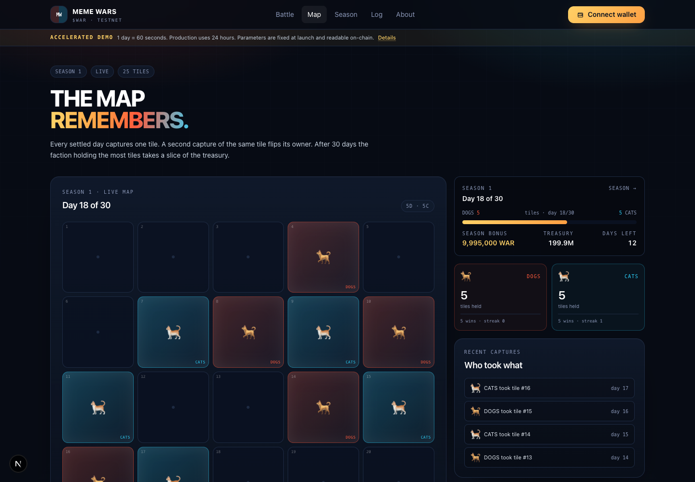
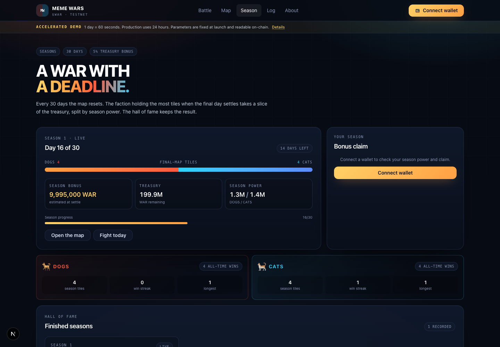
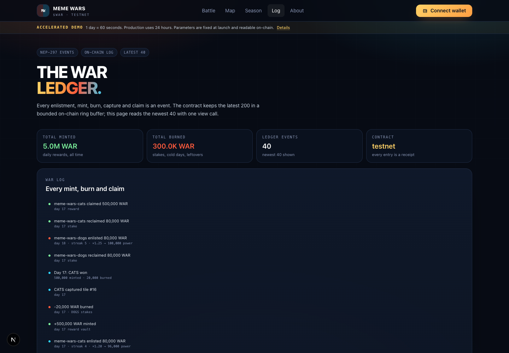
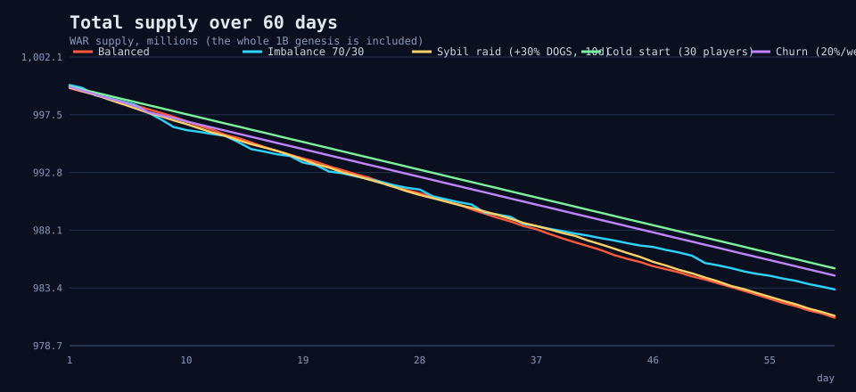
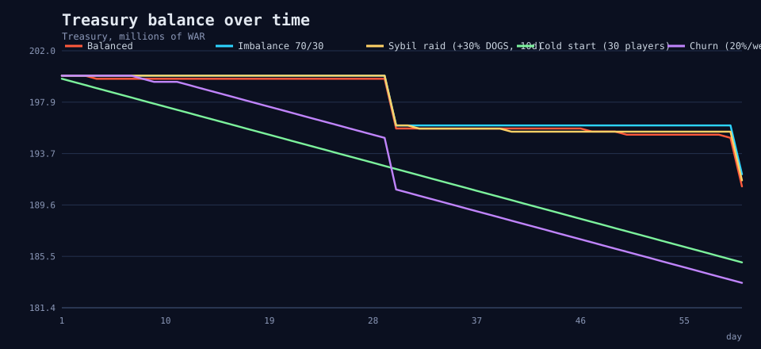
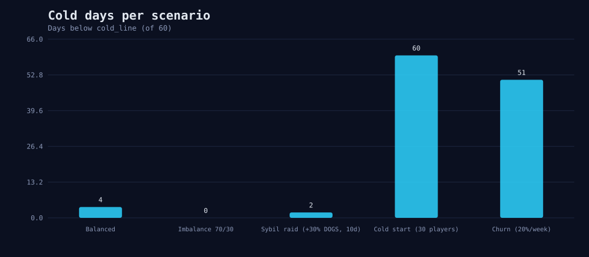
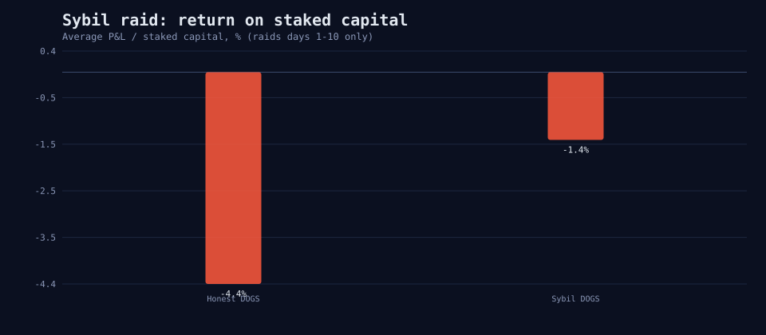

# Meme Wars ($WAR)

**Two factions. One map. Every day the losing stake burns.**

Meme Wars is a NEP-141 memecoin whose supply is a function of a daily
two-faction war. Players stake $WAR on **DOGS** or **CATS**; the winning side
splits the day's fixed mint, the losing side's stake is burned 20%, and the
winner captures a tile on a 25-cell map. After 30 days the faction holding the
most tiles takes a slice of the treasury. Every parameter is set at launch and
readable on-chain. There is no admin method, no pause, no upgrade, no oracle
and no backend in the game loop.

- **Track:** NEAR HACKATHON 2026 · `memecoins` — “The joke needs rules.”
- **Demo contract (testnet, 60-second days):** [`war-demo.testnet`](https://explorer.testnet.near.org/accounts/war-demo.testnet)
- **Contract code hash:** `FUPGHgqHTidZM9RMWj9Pg7wbAn2twZz4Fsa6YnuxoGgV`
  (matches `artifacts/meme_wars.wasm`, SHA-256 `d70778ea505882540cdf22cd463502f9134b83e39c06bb20ff717eae33d019ee`)
- **Live frontend:** <https://meme-wars-iota.vercel.app>
  (also runs locally with `npm run dev`; see below).
- **Demo video / X post:** human-owned and pending.
- **Submission:** not sent. The full payload and X draft are in
  [`docs/SUBMISSION.md`](docs/SUBMISSION.md) and must be confirmed by the human.

> Testnet only. Tokens have no monetary value. This is a hackathon MVP, not an
> audited financial product.

## What it is

| | |
|---|---|
| **Problem** | Most memecoins have only a price chart. There is no ritual, no consequence, and the supply is usually a promise from a backend. |
| **Solution** | A NEP-141 token whose supply reacts to a daily game: fixed mint, losing-stake burn, cold-day treasury burn, season bonus. The rules are the contract. |
| **Why NEAR** | Daily play has to be cheap. The contract is one Rust file set, the token is NEP-141, the event ledger is NEP-297, and the frontend needs only a wallet. |

The core loop:

1. **Join** DOGS or CATS once.
2. **Enlist** once a day with a stake between 1,000 and 100,000 WAR.
3. **Settle** when the day ends. The weaker side gets an underdog bonus; the
   winner mints the day's pool, the loser's stake is burned 20%; the winner
   captures tile `(day − 1) mod 25`.
4. **Win the season.** After 30 days the faction owning the most tiles takes
   `season_bonus_bp` of the treasury, split by season power.

Settlement and claims are **O(1)**. The contract never iterates over all
participants; it updates aggregate day totals at settlement, and each claim
reads only the caller's enlistment.

## Do X, see Y — 5 minutes

### Run the frontend

```bash
cd frontend
npm install
npm run dev
# open http://localhost:3000
```

The frontend reads views through a same-origin `/api/rpc` proxy (see
`frontend/src/app/api/rpc/route.ts`) with short caching, so the browser does
not hit the public RPC directly or fight CORS/rate limits.

### Acceptance path

1. Open the app and click **Connect wallet**. Use a NEAR **testnet** wallet
   (MyNearWallet or Meteor are configured).
2. Pick **DOGS** or **CATS**. The choice is permanent for this deployment.
   The join transaction batches the NEP-145 storage deposit and, when the
   demo faucet is eligible, a 100,000 WAR starter claim.
3. Click **Enlist**. Stake 1,000 WAR (or more). See the locked balance, the
   tug-of-war bar, the streak strip and the projected power.
4. Wait for the 60-second day to end. Click **Settle day** in the gold banner,
   or let the next enlistment auto-settle it. See the winner, the mint/burn
   rows in the log, and the new map tile.
5. Click **Claim**. See your available balance rise and a `reward_claim` /
   `stake_claim` row appear.
6. Open **Map**: the 5×5 grid is the current season; a recapture flips a tile.
7. Open **Season**: tiles, season power and the bonus estimate. A demo season
   is 30 minutes; the hall of fame fills when it settles.
8. Run the simulation:

```bash
python3 sim/simulate.py
# then open sim/results/supply.svg and sim/results/summary.json
```

### Demo data is labeled

The testnet demo has two seeded players, `meme-wars-dogs.testnet` and
`meme-wars-cats.testnet`, driven by `scripts/keeper.mjs`. They are **demo
bots**, not real users; their names appear in the log. The keeper settles the
finished day, claims for both sides and re-enlists with alternating primary
stakes so the map has a contest. It is optional: any wallet can call
`settle_day`, and `enlist` auto-settles up to seven overdue days. The keeper's
keys live in `~/.near-credentials` (outside this repository).

### Screenshots (local testnet, live demo data)

| Battle | Map |
|---|---|
|  |  |

| Season / hall of fame | War log |
|---|---|
|  |  |

Mobile: [battle](docs/screenshots/battle-mobile.png) ·
[map](docs/screenshots/map-mobile.png)

### Demo video (50s)

[`docs/demo/meme-wars-demo.mp4`](docs/demo/meme-wars-demo.mp4) — 1280×720,
silent, recorded from the live site with title/outro cards. Intended for the X
demo post.

## Hard requirements — evidence

| Requirement | Where it lives | Evidence |
|---|---|---|
| **NEP-141 token** | `ft_transfer`, `ft_transfer_call`, `ft_balance_of`, `ft_total_supply`, `ft_metadata`, NEP-145 storage in `contracts/meme-wars/src/lib.rs` | [`ft_transfer` tx](https://explorer.testnet.near.org/transactions/E8wvCSspQ42UWn8DyLcYqxHuaZWLYETytVGbwwXiwEty) · `ft_metadata` on the contract |
| **Mechanic in the contract, not a backend** | `join_faction`, `enlist`, `settle_day`, `claim_*`, seasons all in Rust | [`enlist` tx](https://explorer.testnet.near.org/transactions/424JqsdmPA7JjveiJu93ExL8MF1VX3WHMrjoEwj52aS1) · [`settle_day` tx](https://explorer.testnet.near.org/transactions/6RJsPTJ2ZVt2kjtbNZXmWH87p3hfdcktuFBQ3N4wt2iH) · `get_log_tail` |
| **Parameters fixed at launch, no admin** | `new(config)` is the only initializer; no `set_config`, `pause`, `upgrade` or `withdraw_treasury` | `get_config` returns the same values forever; `scripts/verify.sh` greps the source |
| **Demo-grade sybil resistance + limits written plainly** | Stake cost, min/max per account, fixed daily pool, streak multiplier, underdog, season power | 60-day simulation, `docs/PARAMS.md`, “Limitations” below |
| **Page shows streak, progress, mint/burn log** | Battle page countdown/tug bar/streak strip; `/log`; `get_log_tail` | Screenshots above; every row is a NEP-297 event |
| **60-day simulation first** | `sim/simulate.py`, five scenarios, sensitivity, fixed seed, no third-party dependencies | `sim/results/*.svg`, `sim/results/summary.json`, `docs/PARAMS.md` |

The live `memecoins` track asks for community-reactive supply, rule-based
treasuries and onchain rituals, judged on the mechanic rather than the chart.
This project has all three: the daily winner mints and the loser burns, cold
days burn the treasury, the 30-day season pays from a rule-based treasury, and
the daily enlist/settle plus the 25-cell map are the ritual. `$WAR` is NEP-141.

## The mechanic

All amounts are integers; ratios are basis points (10,000 = 100%). The
formulas are implemented in Rust and mirrored by the simulation.

```
multiplier_bp = 10000 + min(streak, streak_cap_days) * streak_step_bp
power         = stake * multiplier_bp / 10000
effective     = weaker_side_power * underdog_bonus_bp / 10000
winner        = argmax(effective); exact tie = full refund
loser burn    = losing_total_stake * loss_burn_bp / 10000
reward_i      = daily_mint_pool * power_i / winning_base_power
season bonus  = treasury * season_bonus_bp / 10000
season_i      = season_bonus * season_power_i / winner_season_power
```

- **Cold day:** total base power below `cold_line` → all stakes are refunded,
  the treasury burns `cold_burn`, no mint, no tile, both faction win streaks
  reset.
- **Tie:** all stakes refunded, no mint, no tile.
- **Tile ownership:** a later capture of the same tile moves ownership from
  the previous faction. The season winner is decided by the **final map
  ownership counts**, not by the number of daily wins.
- **Supply lines:** winners' mint, losers' burn, cold-day treasury burn, and
  season bonus. Rounding dust stays in the reward/season vaults; unclaimed
  rewards are burned after the claim window. Stakes themselves never expire.
- **Locked stakes** are not part of `ft_balance_of`, so `ft_transfer` can never
  move an enlisted stake.
- **Bounded work:** `enlist` auto-settles at most 7 days; the log is a
  200-entry ring buffer; settlement is one day per call; claims are one day
  per call.

## Parameters

### Production recipe (`config/prod.json`)

| Parameter | Value |
|---|---:|
| Day | 24 hours |
| Season | 30 days |
| Daily mint | 100,000 WAR |
| Loss burn | 20% |
| Underdog | 2.00× on the weaker side |
| Cold line / burn | 3,750,000 / 250,000 WAR |
| Stake range | 1,000 – 100,000 WAR |
| Streak | +5%/day, cap 20 days (max 2.00×) |
| Season bonus | 2% of treasury |
| Claim window | 7 days |
| Faucet | disabled |

### Demo deployment (`config/demo.json`)

The deployed 60-second demo is intentionally scaled for a small testnet
audience: 500,000 WAR daily mint, 1.50× underdog, 150,000 WAR cold line,
25,000 WAR cold burn, 5% season bonus, 100,000 WAR faucet per account.
Both configs are fixed in `new()`; `get_config` on the deployed contract is
the source of truth. The full tables and the reasons are in
[`docs/PARAMS.md`](docs/PARAMS.md).

## 60-day simulation

```bash
python3 sim/simulate.py
```

No dependencies, fixed seed 42, five scenarios, an accounting assertion every
day, and a self-test that pins the same fixtures as the Rust tests.

| Scenario | Supply Δ (60d) | Cold days | DOGS / CATS wins | Sybil ROI |
|---|---:|---:|---:|---:|
| Balanced | −1.90% | 4 / 60 | 36.7% / 56.7% | — |
| Imbalance 70/30 | −1.67% | 0 | 80.0% / 20.0% | — |
| Sybil raid | −1.88% | 2 | 55.0% / 41.7% | **−1.42%** |
| Cold start | −1.50% | 60 / 60 | 0 / 0 | — |
| Churn | −1.56% | 51 / 60 | 6.7% / 8.3% | — |

The balanced supply is **deflationary**: the losing-stake burns and cold burns
exceed the small daily mint. The treasury never gets close to zero in any
scenario. The balanced day win split is inside 35–65%.

| Supply | Treasury |
|---|---|
|  |  |

| Cold days | Sybil ROI |
|---|---|
|  |  |

Robustness: over 30 seeds, sybil ROI is negative in 22/30 (mean −4.52%), and
the balanced DOGS win rate is inside 35–65% in 29/30. Some seeds turn positive;
this is stated as a limitation, not hidden. Full data:
[`docs/PARAMS.md`](docs/PARAMS.md) · `sim/results/summary.json` ·
`sim/results/sensitivity.csv`.

## Sybil resistance and honest limits

What the contract enforces:

- every enlistment locks real WAR; the loser burns 20%;
- a per-account daily maximum caps one wallet's influence;
- the daily mint is fixed, so extra accounts split the same pool;
- a streak starts at 1.05× and needs 20 consecutive days to reach 2.00×;
- the weaker faction gets a 2.00× underdog bonus in production, so adding
  accounts to the larger side does not automatically buy the day;
- season power is proportional to `stake × streak`, not headcount, so
  minimum-stake sock puppets earn minimum shares.

What it does **not** do:

- A chain cannot prove personhood. These measures raise the cost and dilute the
  payout; they do not stop one person with many funded accounts.
- Sybils can hedge both sides; the losing side still pays the burn, so it is
  not risk-free, but it can smooth outcomes.
- A capital-rich player can move a day. The cap limits one account, not many.
- Faction choice is permanent in this MVP. A 70/30 player split still favors
  the majority (the simulation shows ~80/20 day wins); the daily cap, the
  underdog and the 30-day reset limit the damage but do not erase it.
- The demo faucet exists only in `demo_mode`. The production recipe has no
  free tokens.
- Sybil ROI is negative on average but not in every seed. It is a deterrent,
  not a guarantee.
- No spectator betting markets are shipped. The game is the mechanic.

## Architecture

```
contracts/meme-wars/        NEP-141 + game + settlement + claims + seasons (Rust, near-sdk 5.30.1)
  src/lib.rs                state, init, FT, storage, shared accounting helpers
  src/{config,game,settlement,events,views,types}.rs
  tests/game.rs             28 tests
frontend/                   Next.js 16 + React 19 + Tailwind 4 + Wallet Selector
  src/app/                  Battle, Map, Season, Log, About, /api/rpc proxy
  src/components/           tug bar, countdown, stake form, claims, map, event log
  src/hooks/useGame.tsx     polling snapshot + transaction execution
  src/lib/                  contract types, view helper, wallet provider, actions
sim/                        pure-Python 60-day simulation + committed results
scripts/                    seed.mjs, keeper.mjs, deploy.sh, verify.sh
config/                     demo.json, prod.json, wrapped init args
.github/workflows/ci.yml    contract tests, frontend build, simulation, secret scan
Makefile                    convenience targets (make check)
docs/                       PARAMS, PROGRESS, PARTNERS, SECURITY, SUBMISSION, HOSTING, screenshots
```

### Contract API

**NEP-141:** `ft_transfer`, `ft_transfer_call`, `ft_resolve_transfer`,
`ft_balance_of`, `ft_total_supply`, `ft_metadata`; **NEP-145:**
`storage_deposit`, `storage_withdraw`, `storage_unregister`,
`storage_balance_of`.

**Game:** `new(config)`, `join_faction(faction)`, `enlist(stake)`,
`settle_day(day)`, `claim_stake(day)`, `claim_reward(day)`,
`claim_season(season)`, `close_claims(day)`, `claim_faucet()`.

**Views:** `get_config`, `get_clock`, `get_stats`, `get_member`,
`get_factions`, `get_day(s)`, `get_season(s)`, `get_season_player`, `get_map`,
`get_log`, `get_log_tail`, `get_claims`, `get_enlistment(s)`,
`get_enlist_preview`, `get_player_balance`, `check_supply`.

**Events (NEP-297 `EVENT_JSON`):** `join_faction`, `faucet_claim`, `enlist`,
`reward_mint`, `stake_burn`, `cold_day`, `map_capture`, `day_settled`,
`stake_claim`, `reward_claim`, `season_end`, `season_claim`, `claims_closed`,
`season_claims_closed`. The latest 100 are readable with `get_log_tail`; the ring holds 200 and `get_log` pages by id.

There is deliberately **no** `set_config`, `update_config`, `pause`, `upgrade`
or `withdraw_treasury`.

## Testing and verification

CI runs contract tests, the frontend production build, the simulation and the
secret scan on every push/PR (`.github/workflows/ci.yml`). Locally:

```bash
# macOS: this environment needs the CLT SDK for cargo/make
DEVELOPER_DIR=/Library/Developer/CommandLineTools make check
# or individually:
# contract: 28 tests (NEP-141, join/enlist rules, streaks, underdog,
# tie, cold, burns, claims, seasons, map recapture, invariants)
cd contracts/meme-wars
DEVELOPER_DIR=/Library/Developer/CommandLineTools cargo test

# frontend: typecheck + production build (includes the /api/rpc route)
cd frontend
npm install
npm run build

# simulation: self-test + all scenarios + charts
python3 sim/simulate.py

# on-chain acceptance: views, supply invariant, forbidden admin methods
CONTRACT=war-demo.testnet ./scripts/verify.sh
```

The contract was built with `cargo near build non-reproducible-wasm` using
Rust 1.95.0 (pinned in `rust-toolchain.toml`), with
`--remap-path-prefix=${HOME}=/home/builder` so the binary does not embed a
local home path. The deployed code hash matches the committed artifact in
`artifacts/meme_wars.wasm`; see the top of this README.

## Security / trust surface

- **No admin:** the only initializer is `new(config)`; parameters are immutable.
- **No external calls in the core path:** enlist/settle/claim do not call other
  contracts. `ft_transfer_call` uses the standard NEP-141 resolver.
- **No randomness or oracle:** outcomes depend only on on-chain state.
- **Checked math:** `checked_*` for additions/subtractions, 256-bit
  intermediate for `a*b/c` reward shares, basis points instead of floats.
- **No unbounded loops:** 7-day auto-settle cap, one day per settle, bounded log.
- **Locked stakes are excluded from `ft_balance_of`**, so they cannot be
  transferred.
- **Force unregistration is disabled** so a positive balance is never silently
  burned.
- **Testnet demo caveat:** the deployer still holds the demo contract account's
  full-access key for hackathon iteration. The contract has no upgrade method,
  but a key holder could redeploy the code. The production checklist is to
  remove every full-access key after deploy and record the transaction; this
  has not been done on the demo. The demo also holds the community allocation
  (698M WAR after seeding). Both facts are disclosed rather than implied away.
- No secrets are in the repository. The live scripts read keys from
  `~/.near-credentials`; `.env*` is gitignored; `scripts/check-secrets.sh`
  checks the tree.

More detail: [`docs/SECURITY.md`](docs/SECURITY.md).

## Partner integrations

The core game has **zero partner dependencies**. Nothing in `enlist`,
`settle_day` or the claims calls a partner, and no partner can pause the game,
change a parameter or move the treasury.

| Partner | Status | Note |
|---|---|---|
| meme.cooking | explored, not integrated | The mechanic needs native mint/burn; the demo is a self-deployed NEP-141. |
| NEAR Intents | explored, not integrated | 1Click has no testnet; no fake swap flow is shown. |
| HOT | explored, not integrated | Wallet Selector (MyNearWallet, Meteor) is the onboarding path. |
| Rhea | explored, not integrated | No mainnet liquidity was created for the testnet demo. |
| NEAR.AI / BRRRAIN | not shipped in MVP | A War Prophet would be an off-chain player, never an admin. |
| Trezu / SputnikDAO | ops only | Optional ops tooling; never controls game parameters. |

Full matrix and reasons: [`docs/PARTNERS.md`](docs/PARTNERS.md).

## Deployment

### Demo (60s)

The demo contract at `war-demo.testnet` was deployed from
`config/demo.init.json` (the raw config wrapped as `{ "config": ... }`, which
is what near-sdk's generated `new` expects).

```bash
cd contracts/meme-wars
# Remap the local home path so the wasm does not embed a personal directory.
cargo near build non-reproducible-wasm \
  --env "RUSTFLAGS=--remap-path-prefix=${HOME}=/home/builder"
near contract deploy war-demo.testnet use-file target/near/meme_wars.wasm \
  with-init-call new file-args ../../config/demo.init.json
```

A code-only update (state preserved) uses the same sanitized build and
`without-init-call`; `scripts/deploy.sh` does this with `FRESH=0`.

### Production recipe (24h)

Use `config/prod.init.json`. Create a fresh account/contract (a new account is
required because `new` can only run once) and deploy. Then remove the
full-access key(s) with `near account delete-keys` and record the transaction.
Do not deploy the 24h recipe on top of the demo state.

### Frontend hosting

The app needs a Node runtime for `/api/rpc`; it is not a static export. Set:

```
NEXT_PUBLIC_NETWORK_ID=testnet
NEXT_PUBLIC_CONTRACT_ID=war-demo.testnet
NEXT_PUBLIC_RPC_URL=https://test.rpc.fastnear.com
NEXT_PUBLIC_EXPLORER_URL=https://explorer.testnet.near.org
NEAR_RPC_URL=https://test.rpc.fastnear.com
NEAR_RPC_FALLBACK_URL=https://rpc.testnet.near.org
```

then `npm install && npm run build && npm run start`, or deploy to
Vercel/Netlify. On Vercel set **Root Directory = `frontend`** and keep the
default Next.js build; `/api/rpc` needs a Node/serverless runtime, not a
static export. The demo is live at <https://meme-wars-iota.vercel.app>.
The exact GitHub → Vercel → X → submission sequence, including switching
accounts and the environment variables, is in
[`docs/HOSTING.md`](docs/HOSTING.md).

## Build disclosures

- **New project.** Meme Wars was built during the NEAR Hackathon 2026 window.
  There is no prior product, other-chain version, or old library carried into
  this repo. The demo contract, bots and screenshots are project-owned testnet
  artifacts.
- **AI-assisted.** Claude Code was used for implementation, tests,
  documentation and the simulation. The human set the scope, created and
  deployed the testnet accounts, reviewed the result, and owns the submission.
- **Open-source building blocks.** Rust: `near-sdk`/`near-contract-standards`,
  `primitive-types`, `cargo-near`. Frontend: Next.js scaffold, React, Tailwind
  CSS, NEAR Wallet Selector, `near-api-js`. Simulation: Python standard
  library only. The game contract and battle UI are project-specific; no
  third-party game template or game boilerplate was copied.
- **Demo players.** `meme-wars-dogs.testnet` and `meme-wars-cats.testnet` are
  project-owned demo bots, labeled in the event log and README. Their keys are
  outside the repository.
- **Other projects.** This README describes only Meme Wars. If the human
  submits a second independent project under the same person, each README must
  name the other; do that before submitting.

## What remains (human decisions)

These are intentionally **not** filled in by the agent:

- X demo post (must say “built at NEAR HACKATHON”, tag @NEARProtocol and
  #NEARHackathon, and attach a video/screenshots);
- project name, lead name, contact email, team size;
- mainnet payout account;
- public repository URL and confirmation to push/make it public;
- final track list (`memecoins`; `games` arguably fits the loop — human decides);
- the exact submission payload, sent only after explicit OK.

The live HACKATHON.md submission API uses `requestId`, `projectName`,
`leadName`, `email`, `size`, `tracks`, `nearAddress`, `projectUrl` (repository),
`demoUrl` (X post), `idea`, and `consent`. `website` is a spam trap and must
not be sent. The deadline is **2026-11-14 23:59 UTC**. See
[`docs/SUBMISSION.md`](docs/SUBMISSION.md) for the draft and checklist, and
[`docs/HOSTING.md`](docs/HOSTING.md) for GitHub/Vercel/X steps.

## License

MIT — see [LICENSE](LICENSE).
